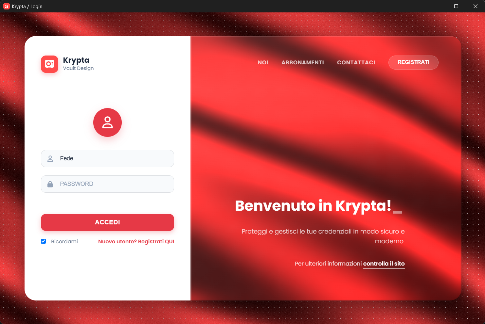
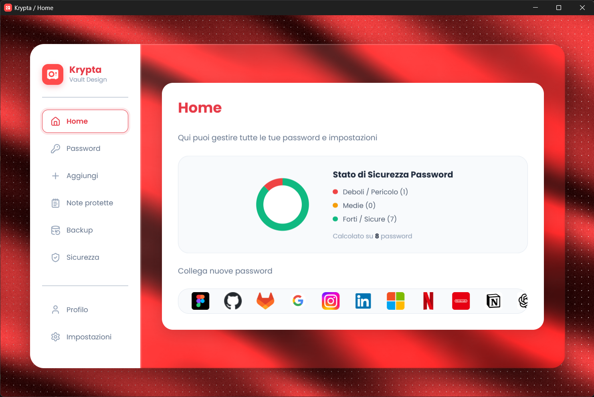
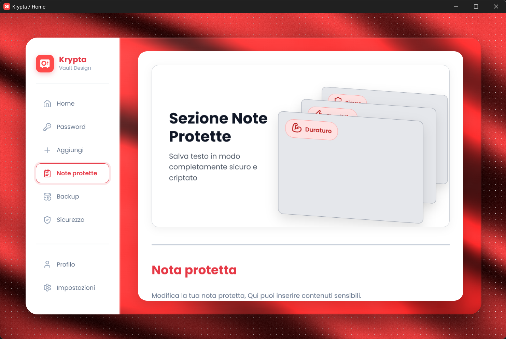
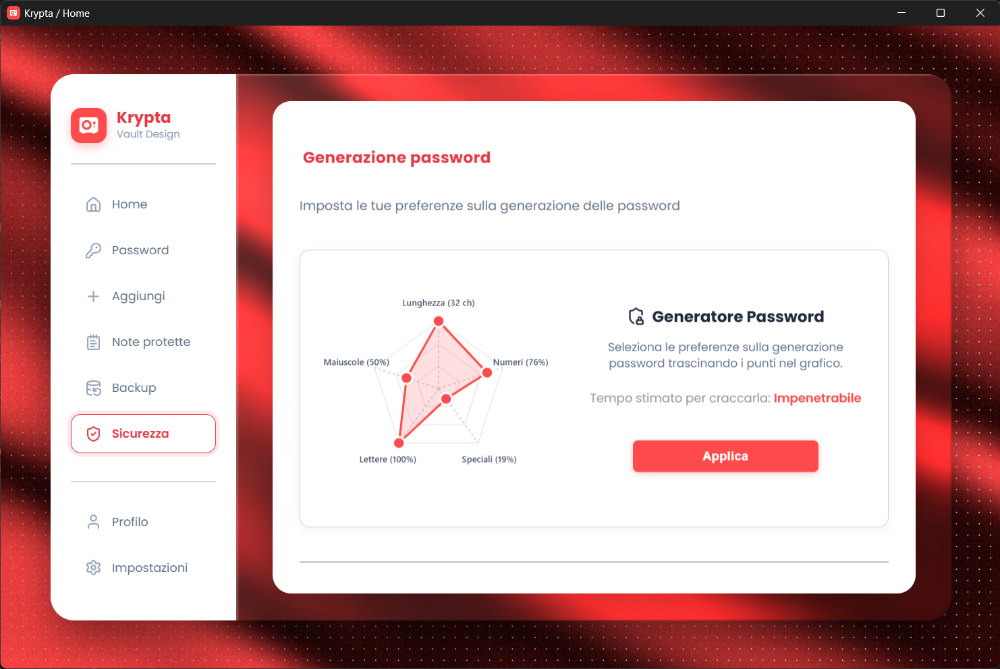
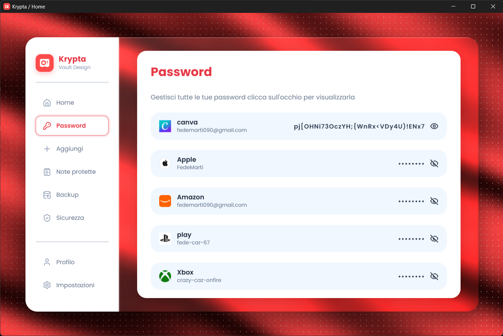
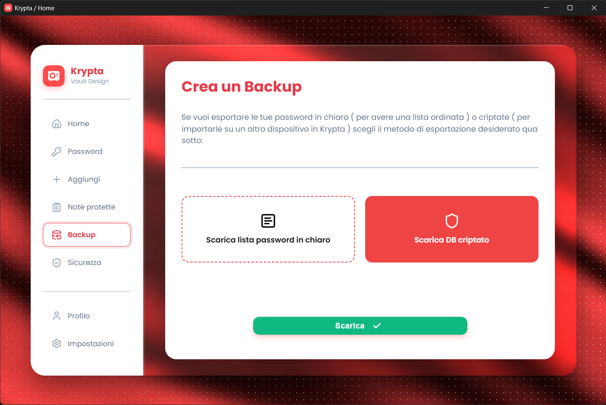
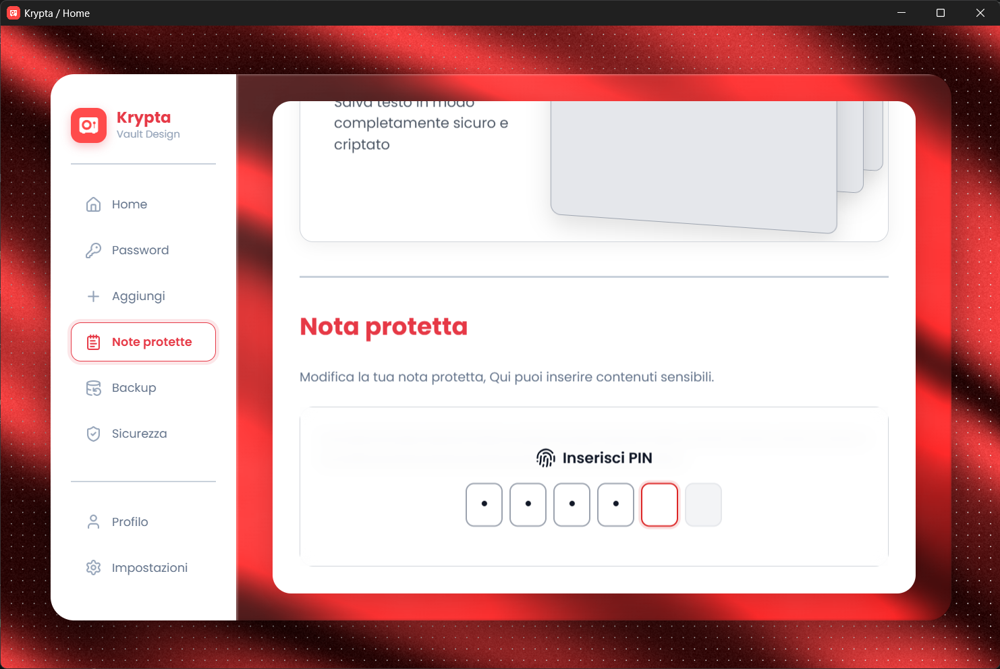
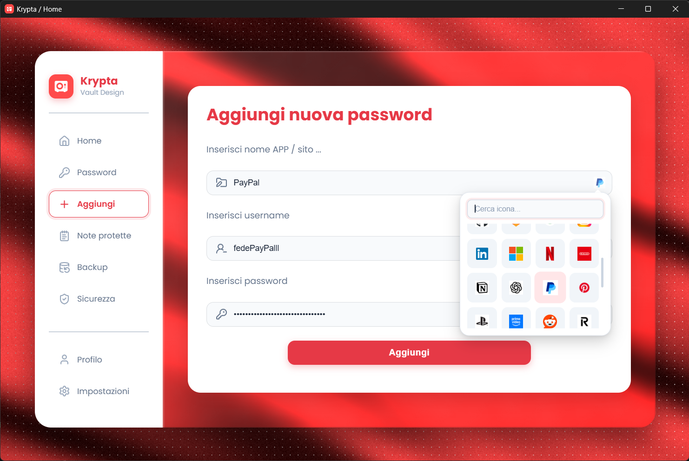

# Krypta

**Krypta** è un password manager e vault desktop ad alte prestazioni, sviluppato con un'architettura moderna basata su **Electron**, **Express.js** e **SQLite**. Progettato con un forte focus sulla sicurezza informatica e sulla privacy assoluta, implementa un modello **Zero-Knowledge**: i dati sono crittografati localmente e né l'applicazione né il sistema sottostante possono decifrarli senza la chiave primaria dell'utente.

Caratterizzato da un'interfaccia grafica rifinita in stile **Liquid Glass** e animazioni fluide gestite interamente via GPU, Krypta unisce usabilità e robustezza crittografica di livello industriale, predisposta per gli standard Post-Quantum.

---

## Caratteristiche Principali

* **Architettura Zero-Knowledge e Crittografia:**
  * Derivazione della chiave tramite **Argon2id**.
  * Espansione della chiave con **HKDF**.
  * Cifratura simmetrica dei dati con **AES-256-GCM**.
* **Stack Desktop Moderno:** Sviluppato su Electron e Node.js con un server Express locale per gestire in isolamento la logica dei dati.
* **Gestione Completa del Database e Backup:**
  * Importazione ed esportazione di backup (in chiaro o cifrati in formato `.json`).
  * Strumenti integrati per la pulizia e la manutenzione del database e dei registri di sicurezza.
* **Monitoraggio e Sicurezza Avanzata:**
  * Terminale interattivo dei log di sistema per tracciare ogni accesso o modifica.
  * Generatore avanzato di password basato su preferenze granulari.
  * Valutazione in tempo reale della complessità delle password (*Password Strength Evaluator*).
* **Note Protette con PIN:** Sezione isolata per la memorizzazione di informazioni sensibili protetta da un codice PIN dedicato.
* **Interfaccia Utente e UX:** Design system a tema scuro, effetti *Liquid Glass* (`backdrop-filter`), transizioni prive di sfarfallii (prevenzione FOUC) e griglie interattive.

---

## Stack Tecnologico

* **Frontend:** HTML5, CSS3 (Custom Properties & Keyframe animations), JavaScript (ES Modules).
* **Backend e Core Desktop:** Electron, Node.js, Express.js.
* **Database:** SQLite con gestione locale protetta.
* **Sicurezza e Crittografia:** Argon2id, HKDF, AES-256-GCM.

---

## Installazione ed Esecuzione

Assicurati di avere installato **Node.js** sul tuo sistema prima di procedere.

```bash
# Clona il repository
git clone https://github.com/tuo-username/krypta.git
cd krypta

# Installa le dipendenze
npm install

# Avvia l'applicazione
npm start
```

---

## Sicurezza e Privacy

Krypta opera completamente offline e non invia alcuna credenziale o dato sensibile a server esterni. Ogni operazione di cifratura e decifratura avviene esclusivamente sul dispositivo dell'utente. I registri di log interni permettono di monitorare costantemente lo stato di integrità del database.

---

## Anteprime dell'Interfaccia

<table>
  <tr>
    <td align="center"></td>
    <td align="center"></td>
  </tr>
  <tr>
    <td align="center"></td>
    <td align="center"></td>
  </tr>
  <tr>
    <td align="center"></td>
    <td align="center"></td>
  </tr>
  <tr>
    <td align="center"></td>
    <td align="center"></td>
  </tr>
</table>
